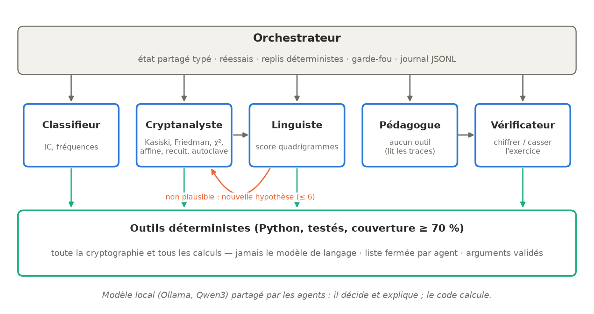

# Résumé

Ce travail présente Vigenère-Squad, un système multi-agents exécutable sur un
ordinateur portable sans GPU qui reçoit un texte chiffré par un procédé
classique (César, affine, Vigenère, autoclave, substitution monoalphabétique,
Beaufort), identifie le procédé, retrouve la clé et le clair, puis rédige une
explication pédagogique et un exercice vérifié. Cinq agents spécialisés
(Classifieur, Cryptanalyste, Linguiste, Pédagogue, Vérificateur), dotés chacun
d'une liste fermée d'outils, sont coordonnés par un orchestrateur explicite avec
une boucle de vérification. Le modèle de langage local (Qwen3 via Ollama)
décide et explique ; toute la cryptanalyse (indice de coïncidence, Kasiski,
Friedman, χ², recuit simulé, attaque de l'autoclave) est réalisée par du code
déterministe testé. Une étude d'ablation sur {{n_corpus}} chiffrés compare une
référence sans modèle à deux tailles de modèle ; elle est complétée par des
expériences de robustesse, de défaillances injectées, d'injection de consignes
et par une comparaison avec la distance d'unicité de Shannon. Tout est
reproductible par `make reproduce` et archivé avec DOI.

# Abstract

This report presents Vigenère-Squad, a multi-agent system that runs on a
GPU-less laptop. Given a ciphertext produced by a classical cipher (Caesar,
affine, Vigenère, autokey, monoalphabetic substitution, Beaufort), it
identifies the cipher, recovers the key and the plaintext, then writes a
step-by-step explanation together with a tool-verified exercise. Five
specialised agents with closed tool lists are coordinated by an explicit
orchestrator with a verification loop. The local language model (Qwen3 served
by Ollama) decides and explains, while all cryptanalytic computation is done
by tested deterministic code. An ablation study on {{n_corpus}} ciphertexts
compares a no-LLM baseline with two model sizes; robustness, fault-injection,
prompt-injection experiments and a comparison with Shannon's unicity distance
complete the evaluation. Everything is reproducible with `make reproduce` and
archived with a DOI.

# Introduction

Au XIX^e^ siècle, Babbage puis Kasiski ont cassé le chiffre de Vigenère par une
démarche méthodique : repérer les répétitions, estimer la longueur de la clé,
ramener le problème à plusieurs chiffrements de César attaqués par analyse de
fréquences. Cette démarche se découpe en rôles (identifier, attaquer, valider,
expliquer), ce qui en fait un banc d'essai naturel pour un système multi-agents.

La question de recherche est double : (1) un petit modèle de langage local,
cantonné à la décision et à l'explication, apporte-t-il un gain mesurable par
rapport à une heuristique codée en dur qui enchaîne les mêmes outils ? (2) à quel
coût (temps, défaillances) et avec quelles garanties de sécurité ?

Contributions : une boîte à outils de cryptanalyse classique testée (couverture
> 70 %) ; une architecture à cinq agents avec liste fermée d'outils imposée au
contrôle et au décodage ; un protocole expérimental à graines fixes avec étude
d'ablation ; une chaîne de publication auditable (traces JSONL, résultats
signés, archive Zenodo).

# Rappels de cryptanalyse

## Indice de coïncidence

L'indice de coïncidence d'un texte de $n$ lettres, d'effectifs $n_i$, est
$IC = \sum_i n_i(n_i-1) / (n(n-1))$. Il vaut environ 0,078 en français et
$1/26 \approx 0{,}038$ pour un texte aléatoire. Une substitution
monoalphabétique conserve l'IC ; un chiffre polyalphabétique le rapproche de
la valeur aléatoire. C'est le premier critère du Classifieur.

## Kasiski et Friedman

Dans un Vigenère, deux occurrences d'un même fragment de clair chiffrées avec
la même portion de clé produisent des répétitions dont les distances sont
multiples de la longueur $L$ de la clé. L'outil `kasiski` recense les
répétitions de trigrammes, compte les diviseurs des distances et privilégie le
plus grand diviseur dont l'effectif reste proche du maximum (pour ne pas
retenir systématiquement 2 ou 3). L'outil `friedman` calcule l'estimation de
Friedman $L \approx (\kappa_p-\kappa_r)\,n / ((n-1)\,IC - \kappa_r n + \kappa_p)$
et, plus robuste sur texte court, l'IC moyen des colonnes pour chaque longueur
candidate ; la plus petite longueur dont l'IC moyen atteint 90 % du maximum
observé est retenue (ce seuil relatif écarte les sous-multiples favorisés par
une clé à lettres répétées).

## Attaque du χ² et escalade

Une fois $L$ fixée, chaque colonne est un César : le décalage minimisant la
statistique du χ² entre fréquences observées et fréquences du français est
retenu. La clé est ensuite affinée par escalade : chaque lettre est remplacée
par celle qui maximise le score de quadrigrammes du texte entier.

## Score de quadrigrammes et recuit simulé

Un modèle de langue par quadrigrammes (log-probabilités, plancher pour les
quadrigrammes absents) est appris sur trois romans du domaine public (Zola,
Hugo), disjoints des textes utilisés pour les chiffrés. Le score normalisé vaut
0 pour un texte aléatoire et 1 pour un texte français typique ; c'est la mesure
de plausibilité du Linguiste. Pour la substitution quelconque ($26! \approx
2^{88}$ clés), un recuit simulé échange deux lettres de la permutation et
accepte une dégradation avec une probabilité décroissante, avec redémarrages
à graine fixe.

## Autoclave

Dans l'autoclave (clé auto), la clé est l'amorce suivie du clair lui-même :
$c_i = p_i + k_i$ avec $k_i = p_{i-L}$ pour $i \ge L$. Le flux de clé ne se
répète pas, ce qui prive Kasiski de son fondement. En revanche, pour une
longueur d'amorce $L$ donnée, la colonne $j$ (positions $j, j+L, j+2L, \dots$)
ne dépend que de la lettre d'amorce $K_j$ : $p_j = c_j - K_j$, puis
$p_{j+rL} = c_{j+rL} - p_{j+(r-1)L}$. Chaque colonne est donc attaquée
séparément sur 26 hypothèses par χ², puis la clé est affinée par escalade, et la
meilleure longueur est retenue. L'expérience de la section « Résultats » montre
l'échec de Kasiski sur l'autoclave :

{{TABLE_kasiski}}

{width=70%}

## Distance d'unicité de Shannon

Shannon définit la distance d'unicité $U = H(K)/D$, où $H(K)$ est l'entropie de
la clé et $D$ la redondance de la langue par lettre. Pour un Vigenère à clé
aléatoire de longueur $L$, $H(K) = L \log_2 26 \approx 4{,}70\,L$ bits. La
redondance est estimée à partir du modèle de quadrigrammes :
$D = \log_2 26 - H_4$ où $H_4$ est l'entropie conditionnelle
$H(X_4|X_1X_2X_3)$ = {{entropie_estimee}} bits, d'où D = {{redondance_estimee}}
bits ; on compare aussi à la valeur classique $D \approx$ {{redondance_litt}}
bits (entropie du français ≈ 1,3 bit par lettre).

# Architecture du système

{width=95%}

## Agents et liste fermée d'outils

| Agent | Rôle | Outils autorisés | Sortie |
|---|---|---|---|
| Classifieur | mono/poly, ordre des hypothèses | `indice_coincidence`, `frequences` | `famille`, `procedes_probables`, `justification` |
| Cryptanalyste | choisit et paramètre l'attaque, désigne le résultat | `kasiski`, `friedman`, `chi2_cesar`, `force_brute_affine`, `attaque_vigenere`, `attaque_beaufort`, `attaque_autoclave`, `recuit_substitution` | `id_resultat`, `procede`, `justification` |
| Linguiste | juge la plausibilité, renvoie en arrière | `score_quadrigrammes` | `plausible`, `justification`, `procede_suivant` |
| Pédagogue | explication pas à pas, exercice (nouvelle clé) | aucun (lit les traces) | `explication`, `exercice` |
| Vérificateur | vérifie le corrigé de l'exercice | `chiffrer_exercice`, `casser_exercice` | `valide`, `commentaire` |

Les cinq agents partagent un même modèle chargé en mémoire ; ils se distinguent
par leur prompt système (fichier versionné, version et empreinte SHA-256
enregistrées dans chaque trace), leurs outils et leur schéma de sortie Pydantic.

## Protocole d'appel d'outils

À chaque tour, le modèle renvoie un objet JSON `{"pensee", "appels",
"conclusion"}` dont le schéma est transmis à Ollama (décodage contraint). Si
`appels` n'est pas vide, l'orchestrateur : (1) refuse tout outil hors de la
liste de l'agent ; (2) valide les arguments (Pydantic, champs inconnus
interdits, bornes) ; (3) exécute l'outil avec un délai maximal ; (4) renvoie un
résumé compact. Sinon, la conclusion est validée par le schéma de l'agent.

Deux choix limitent ce que le modèle peut altérer : le texte chiffré n'est
jamais un argument (il est injecté depuis l'état partagé), et le clair annoncé
est toujours celui d'un résultat d'outil désigné par identifiant (`R1`, `R2`…).
Le modèle ne peut donc ni modifier le chiffré, ni fabriquer un clair.

## Boucle de vérification, réessais et replis

Le Cryptanalyste propose un résultat, le Linguiste le juge ; s'il n'est pas
plausible, le procédé est rejeté et une nouvelle hypothèse est tentée (au plus
6 itérations, une par procédé). Un procédé déjà rejeté ne peut pas être reproposé : la trace d'un
premier essai avec `qwen3:0.6b` montrait un Cryptanalyste relançant quatre fois César et épuisant la
boucle. Un **garde-fou** déterministe refuse un « plausible » dont le
score normalisé est inférieur à 0,65. Ce seuil a été mesuré sur le corpus : les bons
clairs obtiennent au moins 0,70 (texte de 80 lettres) et les clairs erronés produits par une mauvaise
attaque au plus 0,62 (80 lettres) et 0,48 (150 lettres) ; un premier seuil à 0,45 laissait passer des
clairs erronés lorsque le Linguiste les déclarait plausibles. Chaque appel au modèle bénéficie de deux
réessais (réponse vide, JSON invalide, conclusion hors schéma, délai dépassé) ;
au-delà, l'orchestrateur se replie sur une décision déterministe (classement
par IC, attaque suivante, seuil de plausibilité, explication par gabarit) et le
consigne. Si aucune hypothèse n'est acceptée, le meilleur score est retenu
(statut `meilleur_effort`).

## Référence sans modèle (configuration a)

L'heuristique codée en dur classe le chiffré par IC (seuil 0,060), essaie les
attaques dans un ordre fixe (César, affine, substitution puis Vigenère,
autoclave, Beaufort, ou l'inverse), s'arrête au premier clair dont le score
normalisé atteint 0,70 et retient sinon le meilleur score. Elle utilise
exactement les mêmes outils que les agents.

# Protocole expérimental

## Corpus

Le script `data/generer_corpus.py --seed 42` produit 180 chiffrés par variante :
6 procédés × 6 longueurs (80, 150, 300, 600, 1 000, 2 000 lettres) × 5. Les
extraits commencent en début de phrase dans quatre œuvres du domaine public
jamais utilisées pour l'apprentissage du modèle de langue (Verne ×2, Flaubert,
Voltaire). Clés : César 1–25, affine avec $a \ne 1$ premier avec 26,
permutation aléatoire pour la substitution, mots aléatoires de 3 à 12 lettres
pour les polyalphabétiques. Les textes sources sont épinglés par SHA-256.

Variantes de robustesse : `sans_espaces` (lettres seules), `fautes5` (5 % des
lettres du clair remplacées au hasard avant chiffrement), `anglais`
(*Frankenstein*), évaluée avec le modèle de langue français puis anglais.

## Configurations comparées (ablation)

| Configuration | Description |
|---|---|
| a_baseline | outils + heuristique codée en dur, sans modèle de langage |
| b_qwen3_4b | système multi-agents, Qwen3 4B (≈ 3 Go, exécutable sur 8 Go) |
| c_qwen3_1.7b | système multi-agents, Qwen3 1,7B (taille différente) |

La référence est évaluée sur les {{n_corpus}} chiffrés ; les agents, dont le coût
est plus élevé sur CPU, sur un sous-ensemble stratifié de {{n_agents}} chiffrés
(1 par procédé et par longueur ; 12 chiffrés aux longueurs 150 et 600 pour la robustesse et les
défaillances, 9 pour l'injection de consignes). Ce dimensionnement découle de la vitesse mesurée sur la
machine de l'auteur (≈ 20 s par appel au modèle, ≈ 6 appels par chiffré). Pour une comparaison appariée, la référence est
aussi rapportée sur ce même sous-ensemble. Chaque mesure est répétée 3 fois
(graine du modèle `42 × 1000 + répétition`, température 0,3) et rapportée en
moyenne ± écart type.

## Métriques

Taux de clair exact (toutes les lettres justes), par procédé et par tranche de
longueur ; longueur minimale de succès à 90 % ; taux de procédé correct ;
précision par lettre ; itérations moyennes de la boucle ; temps et mémoire par
chiffré ; taux de repli ; appels refusés ; garde-fous déclenchés ; validité des
exercices ; qualité des explications (grille sur 10, 10 explications tirées au
hasard).

## Matériel et environnement

Matériel : {{materiel}}. Ollama {{ollama}}. Modèles et empreintes :
{{modeles_digests}}. Durée totale de `make reproduce` : {{duree_totale}} min ;
mémoire : {{memoire}}.

# Résultats

## Étude d'ablation

{{TABLE_ablation}}

{width=95%}

Apport mesuré des agents :

{{apport_agents}}

## Taux de succès par procédé et longueur

{{TABLES_tranches}}

{width=100%}

## Longueur minimale de succès par procédé

Mesurée sur une grille fine (20 à 2 000 lettres, 20 tirages par point pour
l'attaque adaptée au procédé connu, 10 pour la référence (a) qui doit aussi
identifier le procédé) ; c'est la plus petite longueur à partir de laquelle le
taux de clair exact reste au moins égal à 90 %.

{{TABLE_longueur_min}}

## Lien avec Shannon

{{TABLE_shannon}}

{width=80%}

La longueur minimale de succès mesurée (longueur de clé connue) vaut entre
{{rapport_shannon}} fois la distance d'unicité estimée. La distance d'unicité
est une borne d'information : au-delà, un seul clair est *possible* en
principe, mais elle ne dit rien de l'effort de calcul. Une attaque statistique
colonne par colonne a besoin de bien plus de texte, car chaque colonne ne
contient que $n/L$ lettres et le χ² y est bruité. L'écart entre « longueur
connue » et « longueur inconnue » mesure le coût de l'estimation de $L$
(Kasiski et Friedman), qui devient dominant pour les clés longues.

## Robustesse, défaillances et injection de consignes

{{TABLE_robustesse}}

{width=95%}

## Explications et exercices

{{explications}}

# Analyse critique

## Apport mesuré des agents

> **À compléter par l'auteur après exécution** : interpréter le tableau
> d'ablation. Points attendus : l'écart de taux de succès agents/référence sur
> le même sous-ensemble est-il supérieur à deux écarts types ? Sur quels
> procédés les agents gagnent-ils (ordre des hypothèses, choix des longueurs) ou
> perdent-ils (Linguiste qui rejette un bon clair, conclusions invalides
> menant à des replis) ? Le surcoût en temps est-il justifié par l'explication ?

Indépendamment des chiffres, deux mécanismes structurent le résultat. D'une
part, la référence (a) dispose déjà des mêmes outils et d'un critère d'arrêt
fiable : sur ce problème bien formalisé, la marge de progression d'un
décideur est faible, et l'apport principal du modèle porte sur l'explication
et l'exercice, que l'heuristique ne produit pas. D'autre part, les échecs des
agents se décomposent en échecs des outils (texte trop court, communs à toutes
les configurations) et en échecs de décision (mauvais procédé retenu, boucle
épuisée), seuls imputables au modèle ; la comparaison appariée sépare ces deux
sources.

## Effet de la taille du modèle

> **À compléter** : comparer b et c (taux de succès, taux de repli, erreurs de
> format, durée).

## Limites

* Sous-ensemble réduit pour les agents (coût CPU) ; la référence couvre tout le corpus.
* Critère « clair exact » strict pour la substitution (lettres rares) ; la
  précision par lettre est publiée en complément.
* Les explications sont notées par l'auteur seul ; une évaluation à l'aveugle
  par plusieurs correcteurs serait préférable.
* Le modèle de langue des outils est appris sur trois romans du XIX^e^ siècle ;
  un style très différent dégraderait la plausibilité.

# Modèle de menace

Le modèle de menace complet (STRIDE) figure dans `docs/modele_de_menace.md`.
Les trois menaces exigées et leurs contre-mesures :

| Menace | Contre-mesures | Évaluation |
|---|---|---|
| Injection de consignes (texte ou sortie d'outil) | textes et résultats déclarés comme données dans les prompts ; garde-fou sur le score ; clair toujours issu d'un outil | expérience `injection` (tableau de robustesse) ; tests automatisés |
| Donnée piégée renvoyée par un outil | sorties typées ; identifiants de résultats vérifiés | test `test_identifiant_invente_par_le_cryptanalyste` |
| Appel d'outil halluciné | liste fermée au contrôle et au décodage ; Pydantic strict ; chiffré jamais passé en argument | test `test_appel_hallucine_refuse_puis_conclusion` ; `appels_refuses_total` ; `scripts/audit_traces.py` |

# Science ouverte et reproductibilité

* Dépôt public, licences MIT (code) et CC BY 4.0 (documentation, données, résultats).
* Version v1.0.0 archivée sur Zenodo (DOI), métadonnées `.zenodo.json` et `CITATION.cff`.
* `make reproduce` : environnement figé (`uv.lock`), modèles exacts (digest
  vérifié avant exécution), données régénérées à graines fixes, toutes les
  expériences, `results/` et page de résultats reconstruits ; exécution reprenable.
* `results/ENVIRONMENT.json` et `results/EXECUTION.json` capturés automatiquement.
* Intégration continue : tests et couverture, gitleaks, `make reproduce-small`
  avec `qwen3:0.6b`, métriques publiées comme artefacts.
* `SHA256SUMS` signé (minisign), clé publique dans le dépôt ; `AUDIT.md` donne
  les valeurs attendues et les tolérances, `make compare` les applique.

Clés de `metrics.json` citées dans la fiche de dépôt :

{{resume_cles}}

# Conclusion

Vigenère-Squad montre qu'un système multi-agents à modèle local peut piloter
une cryptanalyse classique complète sur un ordinateur portable, à condition de
cantonner le modèle à la décision et à l'explication et de l'entourer de
garde-fous déterministes. L'étude d'ablation quantifie l'apport réel des agents
par rapport à une heuristique utilisant les mêmes outils, et l'ensemble des
résultats, y compris les échecs, est publié et vérifiable par un tiers.

Prolongements possibles : Playfair et ADFGVX, Enigma simplifiée par texte
probable, évaluation à l'aveugle des explications par plusieurs correcteurs.

# Références

* C. E. Shannon, « Communication Theory of Secrecy Systems », *Bell System Technical Journal*, 28(4), 1949.
* W. F. Friedman, *The Index of Coincidence and Its Applications in Cryptography*, 1922.
* F. W. Kasiski, *Die Geheimschriften und die Dechiffrir-Kunst*, 1863.
* S. Singh, *Histoire des codes secrets*, Le Livre de poche.
* Project Gutenberg, https://www.gutenberg.org — textes du domaine public.
* Ollama, https://ollama.com ; Qwen3, Alibaba Cloud.

# Annexe : interface en ligne de commande

```
vsquad casser  --texte ... | --fichier ...  [--llm ollama|simule|aucun] [--modele qwen3:4b] [--expliquer]
vsquad rejouer --id <id du corpus> --config b_qwen3_4b [--expliquer]
vsquad traces  <fichier.jsonl>
vsquad evaluer [--sans-llm] [--petit] [--simule]
vsquad metriques | site | environnement
```
